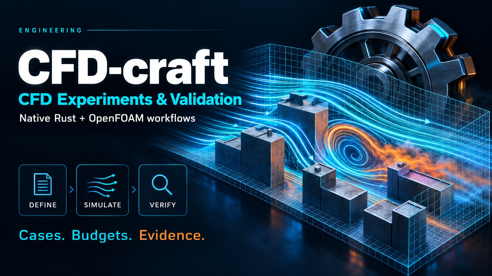

# CFD-craft
<!-- check: rel=1e-4 -->

A Rust CFD research solver for incompressible flow and passive-gas dispersion
on uniform Cartesian grids, used from Python, a JSON command line or Rust, with
a bounded OpenFOAM Foundation 13 backend for cross-checks.

```sh
python -m pip install cfd-craft
```

```python
import json
import urllib.request
import cfd_craft as cfd

url = "https://raw.githubusercontent.com/dietmarwo/CFD-craft/main/examples/manual/point-source.json"
case = json.load(urllib.request.urlopen(url, timeout=30))  # a case is one JSON file
print(cfd.check(case)["valid"])
result = cfd.simulate(case)
print(result["termination"], result["assessment"], result["experimental_validation"])
r_down = result["constituents"][0]["receptors_kg_m3"]["R_down"]
print(f"{r_down * 1e9:.6g} micrograms/m3 at receptor R_down")
```

```text
True
completed steady_discrete_solution not_validated; see validation/data-inventory.json
17.8118 micrograms/m3 at receptor R_down
```

The second line is the point of the tool: why the run stopped, what the
numerical checks support, and the experimental-validation label. Version 0.1.0
is a research prototype. A numerically accepted run is not an experimentally
validated prediction.

Outputs on this page are real. The documentation check compares floating-point
numbers with a relative tolerance of 1e-4; everything else must match exactly.

## Why CFD-craft

- A case is one strict JSON file. An unknown field is an error with a code and the path of the field.
- Every run is bounded in steps, wall time, memory and output, and says why it stopped.
- A result keeps termination, numerical assessment and experimental validation apart.
- A run directory carries hashes of the case, the physics, the initial state, the source and the executable, and an independent checker recomputes the balances from the stored fields.
- It is small and scriptable: in-process from Python, a JSON command line, a Rust library without native scientific-library dependencies; OpenFOAM is optional and stays a separate program.

## Documentation

- [Documentation site](https://dietmarwo.github.io/CFD-craft/): all pages, with search.
- [Guide, chapter 1: First run](docs/guide/01-first-run.md): 21 chapters, smallest case first.
- [How do I …?](docs/how-to.md): tasks in plain words, each linked to the section that does it.
- [Comparison with OpenFOAM and others](docs/comparison.md): features and committed measurements, including where the others are ahead.
- [Reference](docs/reference/README.md): case and result schemas, command line, Python API, units, diagnostics, model cards.
- [Evidence](docs/evidence/README.md): verification and comparison records, failed rows included.
- [For AI agents](docs/ai-context.md): the run loop, the rules and the machine-readable entry points.

<p align="center">
  
</p>

## What 0.1.0 contains

Uniform Cartesian finite volumes with box-shaped solids; laminar flow and one
neutral k-epsilon package; passive gas with point, line and volume sources and
point and volume receptors; bounded runs with checksummed restart; opt-in
second-order momentum, implicit steady iteration and pressure multigrid; an
optional OpenFOAM Foundation 13 backend for two generated cases (a laminar
cavity and a turbulent backward-facing step). It does not contain particles,
vegetation, LES, chemistry, stretched grids or GPU execution.

## Command line and source build

The `cfd-craft` command keeps fields, verified run archives, restart, preview
and profiles. It is built with Rust 1.88 or newer; there is no prebuilt binary.

```sh
cargo install cfd-craft-cli --locked
```

In a checkout:

```sh
cargo build --release --locked
target/release/cfd-craft describe > describe.json
```

Packages: [PyPI `cfd-craft`](https://pypi.org/project/cfd-craft/) (Python), crates.io
[`cfd-craft`](https://crates.io/crates/cfd-craft) (library) and [`cfd-craft-cli`](https://crates.io/crates/cfd-craft-cli) (command).

## Ecosystem

CFD-craft is one of 18 related repositories; the
[repository overview](https://github.com/dietmarwo/fcmaes-rust/blob/main/docs/repositories.md)
shows how they connect.
[optimization-jobs](https://github.com/dietmarwo/optimization-jobs) runs
CFD-craft as an optimization job, and
[experiment-craft](https://github.com/dietmarwo/experiment-craft) schedules
campaigns of such jobs.

## License

MIT. OpenFOAM is not part of this repository; the backend starts it as separate programs.
