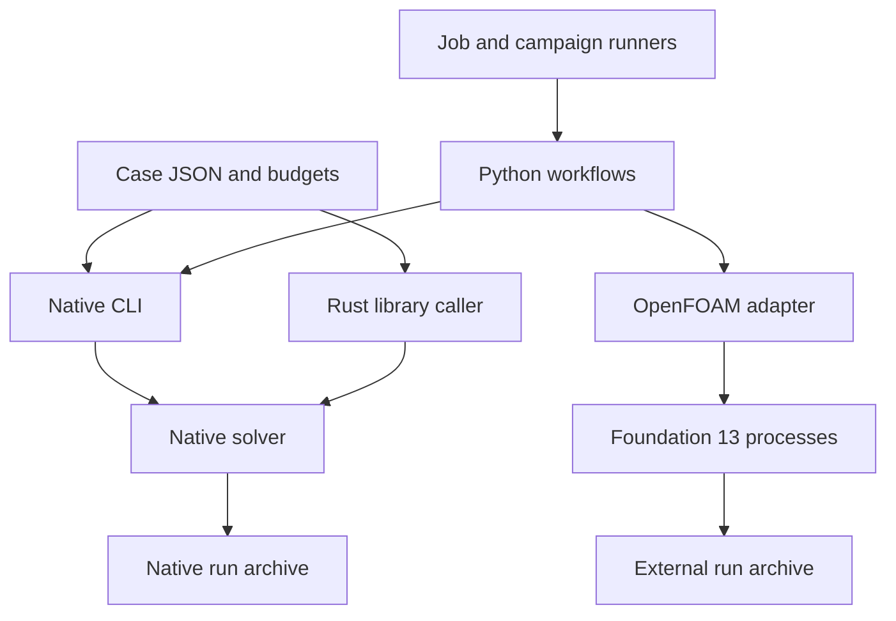
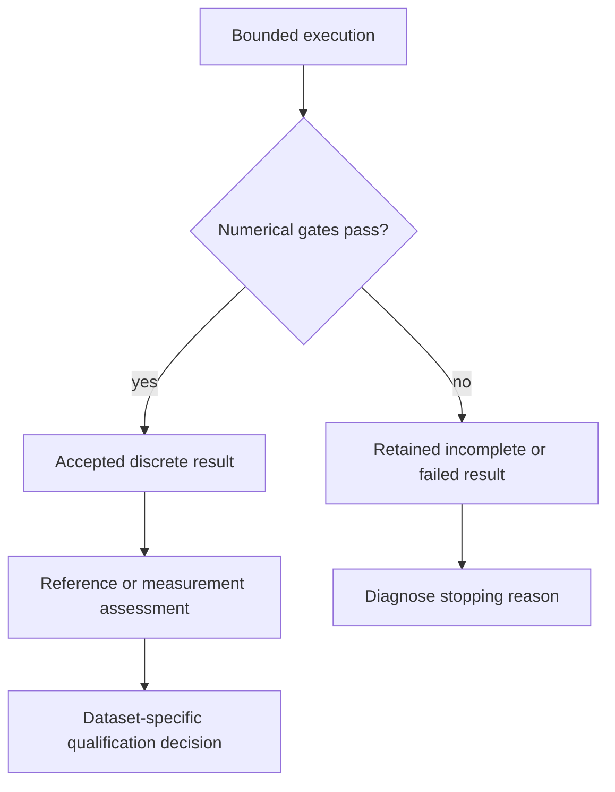

# CFD-craft user manual

CFD-craft makes bounded CFD experiments inspectable and repeatable. It has a
native Rust research solver, a separate OpenFOAM Foundation 13 adapter, Python
analysis workflows, and an optional fcmaes application worker. This manual
explains the architecture, the meaning of the results and the supported APIs.
It describes the current repository implementation. Start with a small case
and retain its evidence before allocating a larger calculation.

The native model is constant-density incompressible flow plus conservative
**passive gas** transport on uniform Cartesian grids. Version 0.1 is a research
prototype. A numerically accepted run is not experimentally validated urban
CFD. Particles, vegetation, LES, chemistry, annual statistics, stretched native
grids and GPU execution are outside the implemented native API.

## Contents

1. [Choose an interface](#choose-an-interface)
2. [Install and run your first case](#install-and-run-your-first-case)
3. [Architecture and ownership](#architecture-and-ownership)
4. [Numerical concepts](#numerical-concepts)
5. [Understand and edit a case](#understand-and-edit-a-case)
6. [CLI cookbook](#cli-cookbook)
7. [Read results and provenance](#read-results-and-provenance)
8. [Native checkpoint and restart](#native-checkpoint-and-restart)
9. [Rust library API](#rust-library-api)
10. [Python automation API](#python-automation-api)
11. [OpenFOAM workflows](#openfoam-workflows)
12. [Optimization and campaigns](#optimization-and-campaigns)
13. [Verification and performance](#verification-and-performance)
14. [Troubleshooting](#troubleshooting)
15. [Example index and further reading](#example-index-and-further-reading)

## Choose an interface

| Goal | Entry point | What it owns |
|---|---|---|
| Run one native simulation | `target/release/cfd-craft` | Case checks, solver, signals, output directory, archive/build identity |
| Embed the native solver in Rust | `cfd_craft::solver::run` | Numerical state and checks; the caller owns its pool, control and publication |
| Script native experiments from Python | CLI through `subprocess.run` | Process orchestration and JSON; no installed Python extension is implied |
| Run a generated OpenFOAM case | `integrations/openfoam_backend.py` | External programs, budgets, dictionaries and separate external archive |
| Compare or analyze fields | `validation/` and `tutorials/` | Independent audits, numerical references and dataset-specific screens |
| Run optimization jobs | Optional `fcmaes-cfd-worker` through optimization-jobs | Fallible simulations, job envelopes and optimizer evidence |
| Coordinate a campaign | experiment-craft | Scheduling and dependencies over existing job envelopes |

The Python modules are source-checkout tools. There is no supported
`pip install cfd-craft` binding in this repository. The native CLI and library
do not require OpenFOAM. The external adapter starts separate executables;
it does not link OpenFOAM into the MIT Rust library.

## Install and run your first case

Commands in this manual run from the repository root. Use Rust >=1.88. A
Linux-like shell is used for the examples; the external runtime targets Linux.
The core workspace has two crates and uses its committed Cargo lockfile.

Every run writes to a new output path and refuses an existing one (E062 for
the CLI, CFD-U001 for the example scripts). To repeat an example, delete its
earlier output or choose a new name.

### Example 1: build and discover the schemas

```sh
cargo build --release --workspace --locked
mkdir -p runs
target/release/cfd-craft describe > runs/describe.json
```

`describe` contains `case_schema`, `result_schema`, compiler/source identity,
coordinate conventions, exit codes and implemented model choices. These
schemas are generated from the actual Rust types; use them when building a
client. `cfd-craft help` prints the short CLI usage as JSON.

Install analysis tools separately when using Python workflows or field audits:

```sh
python -m venv .venv
. .venv/bin/activate
python -m pip install -r requirements-validation.txt
```

Python dependencies include NumPy, SciPy, Matplotlib and jsonschema. Python
3.10 or newer is suitable for the source tools; CI uses Python 3.12.

### Example 2: a complete point-source calculation

The small [point-source case](../examples/manual/point-source.json) describes
prescribed flow, a passive tracer and a downstream volume-average receptor.
It is a synthetic API example, not a calibrated pollution scenario.

```sh
target/release/cfd-craft check examples/manual/point-source.json
target/release/cfd-craft run examples/manual/point-source.json --output runs/manual-point
target/release/cfd-craft report runs/manual-point
python validation/check_fields.py runs/manual-point
```

The parent `runs` must exist. The destination `runs/manual-point` must be new,
including when a previous run failed. Inspect warnings from `check`, the
returned assessment and the independent audit. Choose a new name for a rerun.

### Example 3: read a receptor in physical units

```python
import json
from pathlib import Path

summary = json.loads(Path("runs/manual-point/summary.json").read_text())
tracer = next(s for s in summary["constituents"] if s["id"] == "tracer")
concentration_kg_m3 = tracer["receptors_kg_m3"]["R_down"]
print("micrograms/m3:", concentration_kg_m3 * 1e9)
print(summary["termination"], summary["assessment"])
```

Use receptor IDs. JSON maps are sorted lexically (`R10` precedes `R2`), so a
position in the map is not a sensor identity. `null` means an unavailable
quantity in its stated context, not zero.

## Architecture and ownership



These paths share experiment concepts, not interchangeable result directories.
Use `cfd-craft report` for native archives and the external adapter's `report`
command for its archives. `complete.json` names an integrity boundary; it does
not claim numerical convergence or empirical validity.

### Repository map

| Path | Purpose |
|---|---|
| `crates/cfd-craft/src/case.rs` | Typed case contract, semantic checks and physics hash |
| `grid.rs` | Uniform cells, staggered faces, box masks and connected components |
| `pressure.rs` | Matrix-free pressure operator, gauges, cached IC(0)/PCG and projection |
| `flow.rs` | Laminar/RANS momentum and turbulence, wall treatment |
| `transport.rs` | Source/receptor weights and conservative scalar transport |
| `solver.rs` | State, control, timestep, transactional step and assessment |
| `output.rs` | Checkpoint compatibility, archive publication and integrity reader |
| `crates/cfd-craft-cli` | Parsing, process/thread/signal policy and build provenance |
| `integrations/` | External solver, restart/mapping and optional job worker |
| `tutorials/` | Scientific workflows and prompts |
| `validation/` | Independent checks, references, contract tests and recorded results |

The first seven Rust filenames above are relative to `crates/cfd-craft/src/`.
The public low-level modules are inspectable research interfaces. For ordinary
applications, prefer `Case`, `Control`, `solver::run` and the CLI/archive API;
using grid, face or state vectors directly requires respecting their invariants.

### Native execution lifecycle

1. Deserialize strict typed JSON and reject unknown fields/variants.
2. Check dimensions, units, budgets, geometry and physical combinations.
3. Build the grid; normalize sources and receptor weights; reject solid support.
4. Initialize or import a compatible state, including cumulative mass budgets.
5. Advance bounded steps while polling cancellation/deadline and assessing fields.
6. Retain the last accepted state and the actual stopping reason.
7. Publish the case, summary, requested fields/checkpoint and manifest/marker.
8. Verify integrity and separately audit archived physical quantities.

The CLI supplies additional host-memory preflight, a Rayon pool, signal
handlers and executable/build identity. The library is designed for callers
that want to own those policies, including optimization workers.

## Numerical concepts

### Grid, velocity, pressure and units

The grid is uniform Cartesian; cell sizes are domain lengths divided by cell
counts. Every native axis needs at least two cells. Boxes mask cells using
cell-center membership. An obstacle containing no cell center is rejected,
rather than silently disappearing. `geometry.json` records the SHA-256 of the
represented mask with its cell counts, solid volume, per-box cell counts and
fluid components; the mask itself is rebuilt from the boxes in `case.json`.

Concentrations, pressure, k and epsilon are cell quantities. Velocity components
live on faces. For dimensions `[nx,ny,nz]`, cells are x-fastest; cell index is
`(k*ny+j)*nx+i`. Face arrays are concatenated by x/y/z component, each x-fastest
with one additional face in a nonperiodic component direction. Periodic face
arrays wrap and do not duplicate an end face. Prefer the VTK exporter or
`Grid::cell_velocity` to hand-written reshaping.

| Quantity | Unit/convention |
|---|---|
| Position and domain size | meters; x east, y north, z up |
| Velocity | m/s |
| Pressure | Kinematic pressure, m2/s2; RANS isotropic 2k/3 absorbed |
| k / epsilon | m2/s2 / m2/s3 |
| Concentration | kg/m3; multiply by 1e9 for micrograms/m3 |
| Diffusivity / viscosity | m2/s |
| Wind direction | Meteorological direction **from**, clockwise from north |

A wind from 270 degrees travels in positive x. A wind from 225 degrees has
positive x and positive y components. Native gas inflows specify zero local
concentration increment; any ambient background is a separate physical
interpretation, not an unadvertised source.

### Pressure projection and flow stepping

An incremental projection makes the face velocity approximately divergence
free, using the same divergence and gradient definitions as the pressure
operator. Each unanchored fluid component has a mean-zero pressure gauge and
net-flux compatibility requirement. The incomplete-Cholesky regularization
changes the preconditioner only, not the solved operator.

The native method uses explicit SSPRK2 stages and an IC(0)-preconditioned PCG
pressure solve. Momentum advection is donor-cell first order; selecting scalar
MUSCL does not make momentum second order. Diffusion and advection constrain
the timestep. `max_time_step_s` is a ceiling, not a promise of fixed dt.

`run.mode=steady` still uses these time steps and stops when the steady gates
pass; `end_time_s` does not bound a steady run (`max_steps` and the wall-time
limit do), and its `physical_time_s` is pseudo-time. It does not select an implicit SIMPLE method. `transient` completes a
physical interval and has its own acceptance meaning. Pressure iteration work,
actual face-flux continuity and boundary balance are separate recorded checks.

### Passive mass and source normalization

For a fixed flow, transport balances face advection/diffusion, physical
sources and boundary fluxes. Each internal face contributes equal and opposite
mass to adjacent cells. The mass budget distinguishes initial, emitted,
inflow, outflow and remaining mass. Concentrations are not clipped to hide a
negative-field failure.

| Source variant | Case fields | Integrated rate |
|---|---|---|
| `point` | `point_m`, `rate_kg_s` | Declared kg/s |
| `line` | `from_m`, `to_m`, `rate_kg_s_m` | Rate times line length |
| `volume` | `min_m`, `max_m`, `rate_kg_s_m3` | Rate times physical box volume |

A line rate of 2e-8 kg/s/m over 5 m emits 1e-7 kg/s. A volume rate of
1e-7 kg/s/m3 over a 1 x 0.8 x 0.8 m box emits 6.4e-8 kg/s. The three canonical
source-response boxes therefore emit 1.92e-7 kg/s altogether. Their declared
volumetric rates are not the total source rates. Source/volume-receptor
intersections with solids reject the case; mass is not redistributed to hide
an invalid source.

Point receptors interpolate from cell centers, clamping at the outer domain
boundary. A positive-weight solid cell invalidates the stencil. Volume-average
receptors integrate exact Cartesian overlap; they are not point samples or
pointwise peak bounds.

`linear_upwind` gives a linear fixed-flow response to source strengths. MUSCL
uses a nonlinear limiter, so exact source superposition is not guaranteed.
Molecular diffusivity and RANS turbulent diffusivity `nu_t/Sc_t` are distinct.
A large molecular coefficient chosen merely to stabilize a canyon can hide
the effect of turbulent Schmidt number.

### RANS and model scope

The implemented neutral k–epsilon package uses a matched logarithmic inlet,
rough-wall stress, wall dissipation and upper-boundary closure. `ground_open_top`
is specific to that RANS closure; applying it to a laminar case is rejected.
Side faces are classified by the declared wind. The wall coefficients,
positive denominators, turbulence floors and cell-width-dependent building
roughness are described in the [flow model card](model-cards/flow.md).

Turbulence state-update floors prevent numerical acceptance. The separate wall
algebraic epsilon minimum has its own documented scope. The empty-ABL gate
covers heights H..5H; lower-height drift remains relevant near the ground.
The illustrative coarse canyon has only one street column at W/H=1, so it
cannot resolve a canyon vortex. Coarse convergence is useful workflow evidence,
not measured street-scale accuracy. Read [tutorial limitations](../tutorials/README.md)
and the [data inventory](../validation/data-inventory.json).

## Understand and edit a case

### Example 4: inspect the complete input

Read [point-source.json](../examples/manual/point-source.json). Nothing outside
the case file configures the solver. The groups are:

| Group | Responsibility |
|---|---|
| `schema_version`, `name` | Versioned type and experiment identity |
| `domain`, `grid` | Domain lengths and three uniform cell counts |
| `boundaries`, `flow`, `moving_walls` | Boundary behavior and prescribed, laminar or neutral-RANS flow |
| `geometry` | Axis-aligned solid boxes with unique IDs |
| `constituents`, `initial_conditions` | Species diffusivity and initial mass/concentration |
| `sources`, `receptors` | Physical support, units and measurement IDs |
| `numerics` | Advection choice, timestep/pressure/steady tolerances, monitor window |
| `run` | Mode, endpoint, step/time/thread/memory budgets |
| `output` | Field/checkpoint retention and output budget |

`moving_walls` (omitted in this example), `geometry`, `constituents`,
`initial_conditions`, `sources` and `receptors` default to empty lists when
omitted. Other fields and variants must match `describe`. A similarly named field from another CFD package is not
accepted. The point coordinate is `point_m`, not `position_m`.

### Example 5: modify an input without changing the original

```python
import json
from pathlib import Path

case = json.loads(Path("examples/manual/point-source.json").read_text())
case["name"] = "point-half-rate"
case["sources"][0]["rate_kg_s"] *= 0.5
Path("runs/point-half-rate.json").write_text(json.dumps(case, indent=2) + "\n")
```

```sh
target/release/cfd-craft check runs/point-half-rate.json
target/release/cfd-craft run runs/point-half-rate.json --output runs/point-half-rate
```

Changing source rate creates a different physical problem and physics hash.
Changing only output policy or run budgets preserves checkpoint physics
compatibility, subject to state dimensions and endpoint checks.

### Example 6: alternative source declarations

The following objects can replace a point object in a compatible case. They
illustrate units; check the complete edited case before running it.

```json
{"kind":"line","id":"S_line","constituent":"tracer",
 "from_m":[1,1,2],"to_m":[1,3,2],"rate_kg_s_m":5e-8}
```

```json
{"kind":"volume","id":"S_volume","constituent":"tracer",
 "min_m":[1,1,1],"max_m":[2,3,2],"rate_kg_s_m3":5e-8}
```

Both emit 1e-7 kg/s, but the spatial fields need not agree. Equal integrated
source strength does not make different supports the same simulation.

## CLI cookbook

### Example 7: validate and handle exit codes

```python
import json
import subprocess

checked = subprocess.run(
    ["target/release/cfd-craft", "check", "examples/manual/point-source.json"],
    capture_output=True,
    text=True,
    timeout=20,
)
body = json.loads(checked.stdout)
if checked.returncode != 0 or not body["check"]["valid"]:
    raise RuntimeError(body["check"]["diagnostics"])
```

Use argument arrays with `shell=False` (the default). Preserve stdout/stderr
for unexpected failures; an I/O error may have no JSON stdout. The complete
Python example handles and records process failures.

| Command outcome | Exit | Interpretation |
|---|---:|---|
| Valid check, accepted solve with all artifacts, consistent native archive, or passed `verify` fixture | 0 | Meaning depends on the command |
| Invalid input or execution/I/O error | 1 | Inspect coded diagnostic/path or stderr |
| `run` with incomplete or failed numerical evidence, or an accepted solve that omitted artifacts over its output budget (E061); a failed `verify` fixture | 2 | Keep the archive and inspect termination/assessment |

`report` can exit 0 for an intact **incomplete** run. It can also repeat an
artifact-omission warning and exit 0. Never use its exit alone as a convergence
test. A complete marker also exists for numerically incomplete runs.

### Example 8: preview with a coarser grid

```sh
target/release/cfd-craft preview cases/verification/periodic-tracer.json \
  --factor 2 --output runs/manual-preview
```

A preview is labeled in `model_scope`. It preserves the physical domain but
coarsens cell counts, with at least two per axis. For obstacle cases the solid
volume must stay within 20% and the fluid-component count must agree. Rejection
with E072/E073 is a geometry/preflight result, not a failed full solve. A
preview is not an accuracy certificate for a fine case.

### Example 9: export actual returned fields

```sh
python validation/export_vtk.py --run runs/manual-point --output runs/manual-point.vtr
```

Open the VTR in ParaView and filter by `fluid_mask`. Native JSON retains face
velocity for continuity audits; exported velocity is cell reconstructed. The
exporter needs fields and refuses an existing destination file. It does not
render a new physical-validation conclusion.

### Example 10: use the pressure fixture

```sh
target/release/cfd-craft verify cases/verification/pressure.json
```

This executes a numerical pressure fixture on the case's grid. It is different
from `report`, which checks an archive. Inspect the returned `passed` value
and the fixture's stated numerical scope.

## Read results and provenance

### Four questions to keep separate

| Question | Evidence |
|---|---|
| What stopped execution? | `termination`, error, work and time |
| Is the requested discrete calculation accepted? | `assessment` and checks recomputed from returned fields |
| Are these files consistent with their identities? | Manifest/marker and archive verifier |
| Does this model match physical experiments for this use? | Dataset-specific validation protocol/report |

A mesh-quality pass, a fitted optimizer objective, convergence, a visually
plausible plot and a matching checksum answer different parts of this table.



### File contract

| File | What to read |
|---|---|
| `case.json` | Normalized consumed case, including defaults |
| `summary.json` | Status, checks, work, units, receptor values and model scope |
| `geometry.json` | Mask SHA-256, cell counts, solid volume, box cells and fluid components |
| `probes.csv` | Final named receptor concentrations in kg/m3 |
| `fields.json` | Optional full state, native face velocity and cumulative budgets |
| `checkpoint.json` | Optional checksummed state and physics identity |
| `manifest.json` | Artifact hashes, omission reasons, input/build/executable/initial-state identity |
| `complete.json` | Manifest hash, written last |

Keep additional commentary, charts and logs beside a native run directory,
not inside it: native `report` rejects unlisted entries. The default CLI archive
writer includes its executable hash. The raw input-file hash, normalized case
hash, physics hash and initial-state hash express different identities.

The CLI source fingerprint covers Rust/TOML files under `crates/`, root
Cargo.toml and Cargo.lock. Adding a Rust example can therefore change that
fingerprint even when numerical source files remain identical. Build identity
and numerical equivalence need their own evidence.

### Example 11: require a numerical verdict explicitly

```python
import json
from pathlib import Path

s = json.loads(Path("runs/manual-point/summary.json").read_text())
if s["assessment"] not in {"steady_discrete_solution", "transient_interval_completed"}:
    raise RuntimeError((s["termination"], s["assessment"], s["error"]))
if not all(c["passed"] for c in s["checks"]):
    raise RuntimeError("A recorded numerical check failed")
```

The independent Python checker reconstructs current continuity, mass,
source-rate/time accounting, receptor values and mask/field consistency.
It does not reconstruct the entire flux time history or independently validate
the RANS model. Unkeyed hashes establish consistency, not authorship.

Steady success is `completed / steady_discrete_solution`. Transient success
is `completed / transient_interval_completed`. Budget exhaustion, cancellation
or divergence is not upgraded to success because the last saved state looks
reasonable. See the [result contract](result-contract.md) for omissions,
relative/absolute scales and unavailable values.

## Native checkpoint and restart

### Example 12: interrupt by work, then resume to the same endpoint

Run [Example 18](#example-18-execute-the-complete-native-api-cookbook) first:
its [Python workflow](../examples/manual/cli_workflow.py) writes
`runs/manual-cli/partial.json` and `full.json`, the periodic-tracer case with
end_time_s=2.0, the partial one changing only max_steps to 5:

```sh
target/release/cfd-craft run runs/manual-cli/partial.json --output runs/partial-demo
# Expected exit 2: iteration_limit / incomplete. Keep the checkpoint.
target/release/cfd-craft report runs/partial-demo
# Expected exit 0: archive integrity, with assessment still incomplete.
target/release/cfd-craft run runs/manual-cli/full.json \
  --restart runs/partial-demo/checkpoint.json --output runs/resumed-demo
```

Use these commands interactively with explicit expected exits rather than
hiding exit 2 in a shell pipeline. The complete workflow checks those exits.

Checkpoint identity (the physics hash) excludes `name`, the whole `run` group
(mode, endpoint, budgets, threads) and `output`. It includes the grid, physics,
sources, receptor definitions and numerics. A checkpoint beyond the new
requested step or physical horizon is rejected (E066). A changed grid is not a
compatible native restart.

The endpoint is unchanged so the same final clipped timestep is used. Compare
`runs/resumed-demo/fields.json` with the uninterrupted run of Example 18,
`runs/manual-cli/cold/fields.json`, to test exact state replay.
Changing the physical endpoint of the partial case can change its clipped
step, so it is not an exact replay experiment.

### Example 13: inspect an interrupted calculation safely

This reads the partial archive written by Example 18.

```python
import json
from pathlib import Path

partial = json.loads(Path("runs/manual-cli/partial/summary.json").read_text())
print(partial["steps"], partial["physical_time_s"], partial["termination"])
# The archive remains useful evidence; an incomplete verdict is preserved.
```

A failed step does not commit its candidate state. The summary and checkpoint
refer to the last accepted state, and the attempted-step failure is recorded.
State counters describe retained steps; an attempted failed step can consume
wall time without advancing those counters.

## Rust library API

The package is `cfd-craft`; the Rust import name is `cfd_craft`. Use a path
dependency to your reviewed checkout. There is no publication step required:

```toml
[dependencies]
cfd-craft = { path = "/path/to/CFD-craft/crates/cfd-craft" }
serde_json = "1"
rayon = "1"
```

These entries illustrate the dependency section of your application's
Cargo.toml. Use your application's own lockfile and an explicit reviewed source
revision in a reproducible build.

| API | Signature/use |
|---|---|
| `serde_json::from_slice::<Case>` | Deserialize the typed case; rejects unknown fields |
| `Case::check()` | `CheckReport` with validity, estimates and diagnostics |
| `Case::validate()` | Result containing the check report, or a serialized error report |
| `Grid::build(&case)` | Build represented topology; source/receptor checks also need transport setup |
| `Source::rate()` | Integrated physical kg/s for the declared source variant |
| `Control::new(seconds)` | Cooperative finite positive wall-time allowance |
| `Control::with_poll(seconds, closure)` | Integrate a fallible external deadline/cancellation checkpoint; any poll error stops the run as `cancelled` (or `wall_time_limit` if the poll returns exactly that text) |
| `solver::run(&case, &control, restart)` | `Result<RunResult>` with summary, state and geometry |
| `output::checkpoint_bytes`, `read_checkpoint` | Checksummed compatible-state export/import |
| `output::create_run_dir`, `write_run` | Publication primitives; caller owns provenance and error policy |
| `output::read_verified` | Native archive integrity reader; inspect the returned summary separately |

`cfd_craft::Result<T>` uses a String error. Inspect the codes and case report
rather than parsing an undocumented English substring. `Control::new` expects
finite positive seconds; validate user input before constructing it.

### Example 14: an in-process typed solve

```sh
cargo run --release --locked -p cfd-craft --example manual_library
```

The complete [Rust source](../crates/cfd-craft/examples/manual_library.rs) loads
`source-response.json`, checks it, creates a one-thread pool, runs the solver,
requires steady acceptance and reports R1 and a dimensionless maximum-receptor
objective. Its central calls are:

```rust
let control = Control::new(case.run.wall_time_limit_s);
let run = pool.install(|| solver::run(&case, &control, None))?;
// Ok(RunResult) can also contain cancellation or an incomplete solve.
if run.summary.assessment != "steady_discrete_solution" {
    return Err(format!(
        "CFD-U001 manual.library.assessment: {} / {}",
        run.summary.termination, run.summary.assessment
    ));
}
```

This is an excerpt inside the complete example, where imports, case and pool
are defined. `Ok(RunResult)` means an inspectable solver outcome, which can
still be cancelled, incomplete or numerically failed. Always inspect it.

The library does not create a Rayon pool from case.run.threads. Its caller
must install an appropriate pool if thread accounting matters. The CLI does
this for you. A bare library result has an empty source_sha256 and package
version only; the CLI adds its actual source/compiler identity. Before using
write_run in another application, fill those fields with that application's
real build identity. Do not copy the CLI's identity into another producer.
The CLI remains the simplest complete publication API.

### Example 15: cancellation and job deadlines

```sh
cargo run --release --locked -p cfd-craft --example manual_control
```

The [source](../crates/cfd-craft/examples/manual_control.rs) demonstrates a
pre-set atomic cancellation flag and a fallible external poll during solving.
Both return cancelled/incomplete results with their actual work. Whatever
message the poll returns, the run ends as `cancelled` (or `wall_time_limit`
when the poll returns exactly that text); the poll's own message is not kept,
so record it in the caller if needed. A job worker
uses its SimContext checkpoint as the external poll. Cancellation is cooperative;
it does not promise interruption between every pair of floating-point operations.
The CLI registers SIGINT/SIGTERM and retains a cancelled run archive.

### Example 16: library checkpoint round trip

```sh
cargo run --release --locked -p cfd-craft --example manual_checkpoint \
  -- runs/manual-checkpoint.json
```

The [source](../crates/cfd-craft/examples/manual_checkpoint.rs) stops the
periodic case after five steps, writes a **new checkpoint file**, reads it for
the full case, resumes and requires exact state equality with an uninterrupted
run, and requires the resumed and cold runs to report different initial-state
identities. The file is a checkpoint, not a complete native run archive.

### Example 17: read a CLI archive from Rust

```sh
cargo run --release --locked -p cfd-craft --example manual_archive \
  -- runs/manual-point
```

The [source](../crates/cfd-craft/examples/manual_archive.rs) prints integrity,
omitted artifacts, numerical assessment and validation label separately.
It can also read a valid incomplete archive and report numerically_accepted=false.
This is useful when a Rust service collects a CLI job's output.

## Python automation API

### Example 18: execute the complete native API cookbook

```sh
python examples/manual/cli_workflow.py --output runs/manual-cli
python -O examples/manual/cli_workflow.py --output runs/manual-cli-optimized
```

The [complete script](../examples/manual/cli_workflow.py) demonstrates real
schema validation, preflight, run, report, independent field audit, receptor
lookup, a doubled-rate linear-response check, invalid input, an incomplete
archive, checkpoint replay, preview and VTK export. It preserves command logs
beside the archives and writes a report. Checks use explicit exceptions and
retain their behavior under optimized Python.

### Example 19: build a fallible optimization objective

The native worker is the complete production-style example of this pattern.
For a Python experiment, the important operations are also visible in the
cookbook: create a fresh case/output, call the CLI, reject any unaccepted
assessment, then extract named receptors. A nonzero exit must not be turned
into a large finite concentration and silently counted as a successful solve.
Preserve failed work separately. Reserve held-out observations before selection.

The source-inference tutorial goes further with a linear response matrix,
nonnegative rates, rank deficiency and model mismatch. Repeated columns can
make source recovery unidentifiable even when the optimizer fits well.

## OpenFOAM workflows

### Example 20: install the pinned external runtime

```sh
python integrations/install_openfoam13.py --output runs/openfoam13
```

This downloads one pinned Ubuntu package, verifies its SHA-256 and extracts a
user-owned runtime with `dpkg-deb`, which must be installed.
It does not install system packages or bundle OpenFOAM into the Rust workspace.
A working existing Foundation-13 runtime can also be supplied. The following
commands use `runs/openfoam13/runtime/opt/openfoam13` as the runtime root.
See [OPENFOAM.md](../integrations/OPENFOAM.md) for dependencies and licensing.

### Example 21: generate, run and inspect a cavity

```sh
python integrations/openfoam_backend.py prepare --case cavity --level 1 \
  --iterations 3000 --output runs/foam-cavity-input
python integrations/openfoam_backend.py run --case runs/foam-cavity-input \
  --foam-root runs/openfoam13/runtime/opt/openfoam13 \
  --timeout-s 180 --output runs/foam-cavity
python integrations/openfoam_backend.py report runs/foam-cavity
```

The supported generated cases are cavity and backstep; this is not a translator
for arbitrary native canyon JSON. blockMesh, checkMesh, foamRun and field
postprocessing are separate bounded processes. The adapter records runtime,
dictionary, mesh, log and output identities. A convergence message alone is
insufficient; residual/continuity/stored-field checks also apply.

### Example 22: use the source-checkout Python adapter

```sh
python examples/manual/openfoam_api.py \
  --foam-root runs/openfoam13/runtime/opt/openfoam13 --output runs/manual-foam
```

The [source](../examples/manual/openfoam_api.py) imports openfoam_backend from
the checkout and calls prepare, run and verify. An intact external archive can
still contain an unaccepted solve; its `numerical.passed` is checked explicitly.
No installed Python binding or native-result schema compatibility is implied.

### Example 23: compare two solvers with a numerical reference

```sh
python tutorials/external_cfd.py --preset cavity \
  --foam-root runs/openfoam13/runtime/opt/openfoam13 --output runs/two-cavities
```

This uses the shared native/OpenFOAM centerline helpers and Ghia stations.
Native uses x/z, OpenFOAM x/y; the direction mapping is explicit. Ghia is a
numerical benchmark. The smoke/study variants add a backstep measurement
screen, using frozen raw Driver--Seegmiller data and different acceptance gates.
Do not describe an unevaluable or unconverged iterate as a validated prediction.

### Example 24: continue on the same external mesh

```sh
python integrations/openfoam_backend.py prepare-restart --source runs/foam-cavity \
  --iterations 3000 --output runs/foam-continuation-input
python integrations/openfoam_backend.py run --case runs/foam-continuation-input \
  --foam-root runs/openfoam13/runtime/opt/openfoam13 \
  --timeout-s 180 --output runs/foam-continuation
```

This initializes a **fresh steady stage** from verified final fields and face
flux. It resets local stage work. Source eligibility requires completed,
finite, independently audited fields; a completed unconverged stage can be
eligible, while a timeout/cancelled/failed run is not. Eligibility for restart
is separate from final numerical or measurement acceptance. Read
[steady continuation](../integrations/STEADY_RESTART.md).

### Example 25: initialize a finer external mesh

```sh
python integrations/openfoam_backend.py prepare-mapped --source runs/foam-cavity \
  --level 2 --iterations 3000 \
  --foam-root runs/openfoam13/runtime/opt/openfoam13 \
  --output runs/foam-finer-input
```

This requires an accepted, independently audited cold-generated source. It
maps volume fields using Foundation-13 mapNearest, preserves target boundary
conditions and lets the fine solver construct its face flux; coarse phi is
not copied. The receipt is replayed independently. Run the prepared case as
in Example 21, with a new output path. Two accepted meshes permit an observable
comparison, not automatic mesh independence or a GCI. See
[mesh initialization](../integrations/MESH_INITIALIZATION.md).

The [refinement campaign](../integrations/REFINEMENT_CAMPAIGN.md) composes
mapping and eligible continuation with a frozen campaign budget. It preserves
source, stages and failures, rechecks parents at collection, and keeps coarse
work separate from cumulative fine work. The recorded fine backstep campaign
stopped at its stage limit without final acceptance; increasing the number of
stages is not an accuracy argument.

| Operation | Meaning | New final gates required? |
|---|---|---|
| Native checkpoint | Compatible discrete state and cumulative budgets, same grid/physics | Yes |
| External steady restart | Fresh steady stage, same mesh/physics/runtime | Yes |
| External mapNearest | Fresh target mesh, mapped volume initial guess | Yes |
| Refinement campaign | Bounded composition with complete provenance | Yes |

## Optimization and campaigns

### Example 26: inspect the application worker

```sh
cargo build --release --locked --manifest-path integrations/fcmaes-cfd-worker/Cargo.toml
integrations/fcmaes-cfd-worker/target/release/fcmaes-cfd-worker describe
```

The optional crate is outside the core workspace and has its own lockfile and
pinned fcmaes-rust/job-API revisions. The model is
`app.cfd.source-allocation`, version 1. It requires prescribed flow, exactly
three equal positive integrated source rates, one species and receptors.

It exposes x0,x1 in [0.1,1.4] and source multipliers x0,x1,3-x0-x1. The third
lies in [0.2,2.8], so all sources remain positive and total emissions are
preserved for equal base rates. The objective is the maximum named receptor
concentration divided by 1e-8 kg/m3. Each successful call requires an accepted
steady CFD solve; SDK deadlines/cancellation propagate through Control.

### Example 27: execute real optimizer jobs

```sh
python integrations/run_jobs.py --runner /path/to/optimization-run --output runs/manual-jobs
```

This uses the worker built in Example 26 (`--worker` defaults to its release
path).

Build optimization-run from optimization-jobs with its lockfile; the existing
integration guide and CI pin the tested runner revision. The script discovers
worker examples, stages hashed case/executable inputs and runs a command job,
evaluate, a hard-capped BiteOpt retry and an experimental GP job. It checks
terminal states, complete accounting, zero failed/cancelled evaluations and
runner result manifests. Inspect the generated `command.json`, `fcmaes.retry.json`
and other named job files rather than constructing fields from memory.

An `execution.command/0.1` envelope describes a process and collected artifacts.
An `optimization.job/0.1` envelope also describes a registered optimizer worker
and versioned payload profile. The optimization result is not itself a CFD
archive or physical qualification. The Python interpreter in a generated
command envelope must be appropriate to the destination node.

The application runs CFD per evaluation; source-inference response reuse is a
separate technique with its own fixed-flow/linear-transport assumptions. An
optimizer's best-found/rechecked value is neither a calibrated posterior nor
an experimental claim. Keep objective calls, SDK rechecks, failed/cancelled
work and CFD steps distinguishable. One small seeded example does not rank
BiteOpt against GP or other optimizers.

experiment-craft schedules the same job envelopes as dependent campaign steps.
It owns placement/dependencies/transfer; CFD-craft owns cases and CFD evidence.
The present adapter has no demonstrated multi-node CFD campaign or new server
API. See [integration details](../integrations/README.md) and
[experiment-craft](https://github.com/dietmarwo/experiment-craft).

### Example 28: prompt an agent with concrete boundaries

> Read docs/USER_MANUAL.md, docs/ai-context.md and the relevant model card.
> Use cases/verification/source-response.json. Keep geometry, source support,
> total integrated emission and receptor IDs fixed. Use the existing scalar
> worker and equal evaluation budgets. Require accepted CFD fields and checked
> native job results. Retain failures and actual work. Hold out receptors
> before selection. Explain concentrations in kg/m3 and micrograms/m3, and
> separate numerical checks from physical validation. Use fresh output roots.

For a new application, define a concrete objective and conservation constraints
before choosing an optimizer. Avoid rewarding lower concentration obtained by
moving the sensor, changing the source inventory or reducing numerical fidelity.

## Verification and performance

### Example 29: run the manual's executable example checks

```sh
cargo build --release --workspace --examples --locked
cargo build --release --workspace --locked
python validation/manual_examples.py --output runs/manual-verification
```

This executes the native Python cookbook normally and under -O, all four Rust
examples, the accepted/incomplete archive distinction and the point-source
case with a field audit. Small runnable API checks keep the manual tied to
compiled APIs. OpenFOAM is optional and not part of this quick execution. With
an installed runtime, the OpenFOAM recipes (Examples 21, 22, 24 and 25, and the
run of the mapped case) run in order as a separate check:

```sh
python validation/manual_examples.py \
  --foam-root runs/openfoam13/runtime/opt/openfoam13 --output runs/manual-foam-check
```

Each row of its report records a step's exit code and result fields; every
step must exit 0.

### Example 30: run scientific workflows

```sh
python tutorials/source_inference.py --preset smoke --output runs/source-inference
python tutorials/canyon_study.py --preset smoke --output runs/canyon-smoke
python validation/scipy_reference.py --output runs/scipy-reference
```

The source-inference workflow checks superposition and inverse identifiability;
the SciPy reference independently assembles a steady transport matrix. Canyon
smoke checks a coarse workflow. The larger study may exhaust budgets; preserve
that result instead of silently loosening thresholds. Model cards define
which analytic, numerical or measurement evidence each workflow supplies.

### Example 31: reproduce the backend timing comparison

```sh
python validation/compare_backends.py --binary target/release/cfd-craft \
  --foam-root runs/openfoam13/runtime/opt/openfoam13 \
  --repeats 1 --timeout-s 180 --output runs/backend-timing
```

Each repeat executes all six orders of the three methods after warmups. Require
accepted runs, identical repeated work/profiles/producer identities and stable
input hashes. Workflow time and named solver time are different measurements:
OpenFOAM's workflow includes meshing, sampling, runtime hashing and process
polling. The native solver's own timer is not the Python helper's full time.

The [recorded two-host comparison](../validation/BACKEND_COMPARISON.md) finds
OpenFOAM's cavity workflow about 4.7–5.5 times faster than native steady, and
its named solver timer about 8.9 times faster. Native uses two span layers,
OpenFOAM one empty layer; numerical schemes and norms differ. This does not
supply a canyon ranking, memory comparison or multi-core scaling result.

The [native performance runner](../docs/iterations/07-14-performance-results.md)
compares two native builds at fixed work and checked fields. Its kernel/step/CLI
speedups are not OpenFOAM comparisons. The separate backend runner measures
configured workflows. Neither measures experimental validity. Pressure/steady
algorithm improvements remain candidates; no numerical tolerance should be
weakened merely to improve a runtime table.

## Troubleshooting

| Symptom | Inspect | Action |
|---|---|---|
| Unknown field or variant | E000 diagnostic path and describe schema | Correct the typed field; do not add ignored options |
| Memory/output preflight fails | E006/E007/E070 and estimates | Reduce scope or use a suitable budget/host; keep failure evidence |
| Host check skips geometry | W070 | Complete grid-dependent checks on a capable host before solving |
| Source or receptor hits a wall | E040/E042 and represented mask | Fix physical support or justified resolution; avoid silent clipping |
| Steady source has no removal path | E020/E043 | Use physical outflow/removal; persistent source in closed periodic volume has no steady state |
| Output exists or parent absent | E062/E063 | Use a new child of an existing parent |
| Run exits 2 | summary termination/assessment and omitted artifacts | Keep the archive; distinguish work limit, failed checks and output omission |
| Archive fails report | E064 and manifest/marker | Preserve the rejected archive; do not rehash it into apparent acceptance |
| Restart rejected | E060/E065/E066 | Check physics identity, checksum, dimensions, memory and new horizon |
| Pressure iteration limit | E033 and work/residuals | Diagnose conditioning/resolution; no convergence claim from saved earlier state |
| RANS floors or large eddy viscosity | Floor count, E054 and model card | Treat it as a regime/numerical failure, not a fix by hidden clipping |
| External timeout or invalid mesh | X004/X006 and logs | Keep final eligibility rules; an earlier snapshot is not a final solution |
| API cookbook fails | U001 `manual.<field>` and saved logs | Build examples, check paths and inspect the precise expected API behavior |

Full codes: [diagnostics](diagnostics.md). The external adapter, comparison
runner and manual examples use distinct coded namespaces. Avoid parsing a
human plot or a bare exit code as the entire scientific verdict.

## Example index and further reading

The 31 numbered examples include short executable native recipes, four
compiled Rust programs, two complete Python scripts, and optional external/job
recipes. Prerequisites and output dependencies are stated where needed.
The quick verification covers the new small native programs and Python
workflow. Installation, larger studies, remote campaigns and heavy external
refinement are opt-in workflows with separate recorded evidence.

| Runnable file | Main API concepts |
|---|---|
| [point-source.json](../examples/manual/point-source.json) | Complete native input, point rate and volume receptor |
| [cli_workflow.py](../examples/manual/cli_workflow.py) | Typed schemas, CLI exit/status, source scaling, replay, preview, VTK |
| [manual_library.rs](../crates/cfd-craft/examples/manual_library.rs) | Case, pool, Control, RunResult, physical units and named receptor objective |
| [manual_control.rs](../crates/cfd-craft/examples/manual_control.rs) | Atomic cancellation and fallible external poll |
| [manual_checkpoint.rs](../crates/cfd-craft/examples/manual_checkpoint.rs) | State checksum, compatible import and exact replay |
| [manual_archive.rs](../crates/cfd-craft/examples/manual_archive.rs) | Integrity reader versus numerical assessment |
| [openfoam_api.py](../examples/manual/openfoam_api.py) | External prepare/run/verify and numerical status |
| [manual_examples.py](../validation/manual_examples.py) | Real executions of the manual's small API examples |

Continue with the [result/provenance contract](result-contract.md),
[model cards](model-cards/README.md), [tutorial catalog](../tutorials/README.md),
[agent context](ai-context.md), [roadmap](roadmap.md),
[native results](../validation/RESULTS.md),
[external results](../validation/EXTERNAL_RESULTS.md) and
[refinement results](../validation/REFINEMENT_RESULTS.md).

The [README banner](images/cfd-craft.jpg) is conceptual artwork, not a stored
simulation field or evidence of physical qualification.
