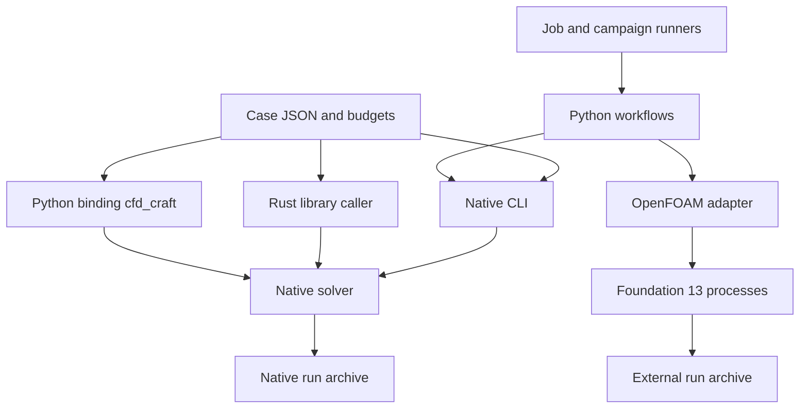

# Architecture

This page shows how the parts of CFD-craft fit together, where each part lives
in the repository and what a native run does from the case file to the archive.
It is for contributors; users start with the [guide](../guide/README.md).

## Components

The CLI, the library and the Python binding share one strict parser and one
preflight (`input.rs`) and one solver. The binding runs the solver in process
and returns a summary; only the CLI writes fields, archives, checkpoints and
profiles. The paths share experiment concepts, not interchangeable result
directories. Use `cfd-craft report` for native archives and the adapter's
`report` command for its archives. `complete.json` marks an integrity boundary;
it does not claim numerical convergence or experimental validity.

## Repository map

| Path | Purpose |
|---|---|
| `crates/cfd-craft/src/case.rs` | Typed case contract, semantic checks and physics hash |
| `input.rs` | Strict JSON parsing and the complete case preflight shared by every interface |
| `grid.rs` | Uniform cells, staggered faces, box masks and connected components |
| `pressure.rs`, `multigrid.rs`, `multigrid/line.rs` | Matrix-free pressure operator, gauges, default IC(0)/PCG, opt-in symmetric point and line multigrid, projection |
| `flow.rs` | Laminar and RANS momentum, turbulence, wall treatment |
| `momentum_solve.rs` | Implicit momentum corrections of the steady algorithms, BiCGStab, CFL ramp |
| `turbulence_solve.rs` | Implicit k and epsilon corrections of `implicit_projection` with RANS |
| `transport.rs` | Source and receptor weights, conservative scalar transport |
| `solver.rs` | State, control, time step, transactional step and assessment |
| `profiling.rs`, `verification.rs` | Phase profile; the pressure fixture of `verify` |
| `output.rs` | Checkpoint compatibility, archive publication and integrity reader |
| `crates/cfd-craft/examples/` | Manual examples, `performance_probe`, `pressure_probe`, `kernel_timing` |
| `crates/cfd-craft-cli` | Parsing, process, thread and signal policy, build provenance |
| `bindings/python`, `python/cfd_craft` | The PyO3 binding (its own workspace) and the Python package with its console script |
| `cases/` | Committed cases: verification, canyon, performance (byte-identical; their hashes are provenance) |
| `integrations/` | OpenFOAM backend, restart and mapping, the optional optimization-job worker |
| `tutorials/` | Studies, source inference, the backstep tutorials and the optimization lessons |
| `validation/` | Independent checks, references, contract tests, benchmarks and the data inventory |
| `scripts/` | Documentation check, reference generator, release checks, case generator |
| `docs/` | Guide, reference, model cards, developer pages, evidence records and history |

The Rust file names from `input.rs` to `output.rs` are relative to
`crates/cfd-craft/src/`. The public low-level modules are inspectable research
interfaces. For ordinary applications prefer `Case`, `Control`, `solver::run`
and the CLI and archive API; using grid, face or state vectors directly
requires respecting their invariants. [Chapter 20](../guide/20-rust-library.md)
of the guide shows the library API.

## Native execution lifecycle

1. Deserialize strict typed JSON and reject unknown fields and variants.
2. Check dimensions, units, budgets, geometry and physical combinations.
3. Build the grid; normalize sources and receptor weights; reject solid support.
4. Initialize or import a compatible state, including cumulative mass budgets.
5. Advance bounded steps while polling cancellation and the deadline and assessing fields.
6. Retain the last accepted state and the actual stopping reason.
7. Publish the case, summary, requested fields and checkpoint, and the manifest and marker.
8. Verify integrity and separately audit archived physical quantities.

The CLI adds a host-memory preflight, a Rayon pool, signal handlers and
executable and build identity. The library is meant for callers that own those
policies themselves, such as optimization workers. The Python binding adds a
cancel file and releases the GIL while the solver runs
([chapter 11](../guide/11-python.md#threads-the-gil-and-concurrent-calls)).

## Where the contracts are written down

- [Result contract](../result-contract.md): status words, archive files, check scope.
- [Diagnostics](../diagnostics.md): every code with the field it names.
- [Model cards](../model-cards/README.md): what each model assumes and what evidence it has.
- [Reference](../reference/README.md): case and result schemas, command line, Python API.
