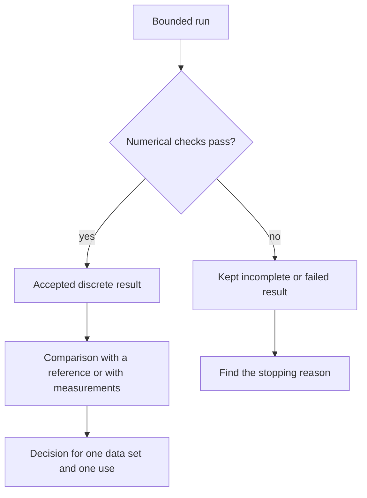

# Can I trust this result?
<!-- check: rel=1e-4 -->

At the end of this chapter you can tell three things apart on any run: why it
stopped, what its numerical checks support, and whether the model was compared
with measurements. You need the `cfd-craft` command and a checkout, as in
[chapter 3](03-cli-and-archive.md).

## Setup

Commands run from the root of a checkout with `cfd-craft` on `PATH`. Every
section reads the point-source run that this block makes:

```bash
mkdir -p runs
cfd-craft run examples/manual/point-source.json --output runs/point > /dev/null
```

Outputs on this page are real. The documentation check compares floating-point
numbers with a relative tolerance of 1e-4; everything else must match exactly.

## Four questions, four kinds of evidence

| Question | Where the answer is |
|---|---|
| What stopped the run? | `termination`, `error`, `steps`, `physical_time_s` in `summary.json` |
| Is the requested discrete calculation solved? | `assessment` and `checks`, recomputed from the final fields |
| Are these files the ones the run wrote? | `manifest.json`, `complete.json` and `cfd-craft report` |
| Does the model match experiments for this use? | `experimental_validation`, and a validation report for a named data set |

A converged residual, a matching checksum, a good mesh, a plausible plot and
a fitted optimizer objective each answer one row of this table, never all four.



## Termination: why the run stopped

| Situation | `termination` | `assessment` |
|---|---|---|
| A steady run met all its criteria | `completed` | `steady_discrete_solution` |
| A transient run reached its end time and its checks passed | `completed` | `transient_interval_completed` |
| A budget ran out, or the run was canceled | `iteration_limit`, `wall_time_limit` or `cancelled` | `incomplete` |
| The run finished and a check failed | `completed` | `failed_checks` |
| A time step failed numerically | `diverged` | `incomplete` |

Only the first two rows are numerically accepted results. `completed` alone is
not enough: read the pair.

## Assessment: what the checks support

The solver recomputes its checks from the final fields and records each one
with its value and its limit.

```python
import json

s = json.load(open("runs/point/summary.json"))
print(s["termination"], s["assessment"])
for check in s["checks"]:
    print(f"{check['name']:27} {check['passed']}  limit {check['threshold']:g}")
```

```text
completed steady_discrete_solution
local_continuity            True  limit 0.0001
boundary_volume_balance     True  limit 1e-05
tracer.mass_budget          True  limit 1e-09
tracer.negative_mass        True  limit 1e-12
tracer.steady_equation      True  limit 1e-05
tracer.steady_mass_balance  True  limit 1e-06
monitor_stability           True  limit 0.001
```

A steady run is accepted when all of these hold: the velocity divergence
(`local_continuity`) and the net boundary flux are within their limits, each
constituent's mass budget closes and no concentration is negative, the steady
equation residual is below `numerics.steady_residual_tolerance`, sources and
inflow balance outflow, and the monitored values (here the receptor) changed
by less than `numerics.steady_monitor_tolerance` over three windows of
`numerics.monitor_window` steps. The run stops at the first step where all of
this holds, not at `run.end_time_s`.

A transient run has a different goal: reach `run.end_time_s` with the
conservation checks passing.

```bash
cfd-craft run cases/verification/periodic-tracer.json --output runs/tracer > /dev/null
```

```python
import json

s = json.load(open("runs/tracer/summary.json"))
print(s["termination"], s["assessment"], s["steps"])
print([check["name"] for check in s["checks"]])
```

```text
completed transient_interval_completed 20
['local_continuity', 'boundary_volume_balance', 'tracer.mass_budget', 'tracer.negative_mass']
```

This case moves a cloud of tracer through a periodic box for 2 s. There is no
steady state to reach, so there are no steady checks.

## An incomplete run is still a result

Give the point-source case a budget of five steps:

```python
import json

case = json.load(open("examples/manual/point-source.json"))
case["name"] = "point-five-steps"
case["run"]["max_steps"] = 5
json.dump(case, open("runs/point-5.json", "w"), indent=2)
```

```bash
cfd-craft run runs/point-5.json --output runs/point-5 > /dev/null || echo "run: exit $?"
cfd-craft report runs/point-5 > /dev/null
echo "report: exit $?"
```

```text
run: exit 2
report: exit 0
```

```python
s = json.load(open("runs/point-5/summary.json"))
print(s["steps"], s["termination"], s["assessment"])
print(f"physical time {s['physical_time_s']:g} s, error: {s['error']}")
```

```text
5 iteration_limit incomplete
physical time 0.5 s, error: None
```

The run exits 2 and writes a complete archive, which `report` verifies with
exit 0. The archive shows how far the run got, and its checkpoint can be
continued ([chapter 8](08-checkpoint-restart.md)). It is not a converged
result, even where single checks already pass.

The saved state is always the last accepted state. A time step that fails is
not committed: summary and checkpoint keep the state before it, `error`
records the failure, and `steps` counts kept steps only.

## Require a verdict in a script

A script that uses a number must test the verdict first, not an exit code.

```python
import json
from pathlib import Path

s = json.loads(Path("runs/point/summary.json").read_text())
if s["assessment"] not in {"steady_discrete_solution", "transient_interval_completed"}:
    raise RuntimeError((s["termination"], s["assessment"], s["error"]))
if not all(c["passed"] for c in s["checks"]):
    raise RuntimeError("A recorded numerical check failed")
```

The block prints nothing for this accepted run. For a five-step run it raises.

## Experimental validation is a separate label

```python
import json

s = json.load(open("runs/point/summary.json"))
print(s["experimental_validation"])
print(s["model_scope"])
```

```text
not_validated; see validation/data-inventory.json
prescribed_flow_passive_transport
```

Every result of version 0.1.0 carries this label, whatever its assessment.
Version 0.1.0 is a research prototype. A numerically accepted run is not an
experimentally validated prediction.

- What exists is verification: comparison with analytic solutions and with
  numerical references such as the lid-driven cavity of [chapter 6](06-flow-cavity.md),
  recorded in [native verification](../evidence/native-verification.md); the
  [evidence index](../evidence/README.md) lists every record.
- What is missing is validation: no result has been compared with measured
  street-canyon data. The raw wind-tunnel files could not be obtained (the
  [data inventory](https://github.com/dietmarwo/CFD-craft/blob/main/validation/data-inventory.json)
  records each attempt), and the first study on finer grids did not finish
  within its compute budgets.

`model_scope` names the model that produced the numbers; the
[model cards](../model-cards/README.md) say what each model assumes.

## Next

- [Chapter 5](05-sources-receptors-transport.md): sources, receptors, schemes.
- [Result contract](../result-contract.md): status words and check limits.
